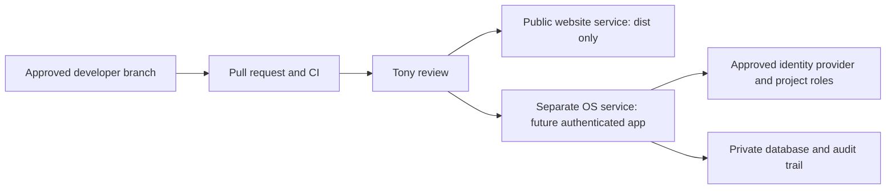

# Hosting decision and prepared configurations

Verified against official documentation November 10, 2026. Prices are USD before tax and usage overages. No Railway/Vercel subscription or account connection was purchased or enabled.

**Recommendation: use Railway Pro as the future unified runtime, with separate website and authenticated OS services. Keep the working Sites review preview during preparation.** This is an architectural recommendation, not authorization to publish the OS.

The current website is a Vite static build with a separate native Node local server. The server binds to loopback and writes enquiry JSONL locally; that is not a durable production lead backend. The OS is currently HTML plus a local JSON export, not a database application. Railway accommodates a future persistent Node backend/Postgres without converting it to serverless functions. Starting with one platform reduces operational overhead; Vercel remains a strong optional frontend choice if the team values its frontend preview workflow enough to maintain two services.

| Factor | Railway | Vercel |
| --- | --- | --- |
| Current website | Prepared static Node host serves only `dist`; Railway PORT and health check supported | Native Vite/static build fit; prepared `vercel.json` |
| Future OS/API | Long-running Node service and separate database fit; application auth still required | Frontend/serverless fit; native HTTP listener and local JSONL persistence need adaptation |
| GitHub / previews | Branch integration and temporary PR environments; contributors need associated workspace/project access | Git-connected deployment previews and production branch workflows |
| Storage / auth | Private service networking can isolate DB traffic; add application identity, project authorization and backups | Use protected data services and application identity; deployment protection alone is insufficient |
| Team cost | Pro $20/month minimum usage, including $20 credit; unlimited workspace seats; resource usage above included credit is extra | Pro $20/month including one deploying seat and $20 usage credit; another deploying seat adds $20/month; usage/add-ons extra |
| Practical tradeoff | One platform for backend, database and web; budget for each running service, backups and egress | Convenient static frontend delivery/preview tooling; backend/data integration adds maintenance |

For two deploying users, Vercel’s verified seat rules imply a $40/month platform/seat starting amount before extra usage. This is a calculation, not a quote for Grama’s total bill. Railway’s $20 minimum is likewise not an all-inclusive application/database/backup estimate. Measure usage in staging and set approved spending limits. Vercel Hobby is restricted to personal/non-commercial use; do not select it for this business website.

No performance benchmark or SLA guarantee is claimed. Test actual images, video delivery, region latency, uptime, backup restore and database load in staging before choosing production capacity.

## Deployment architecture

- Public website and OS use separate services, environment variables, credentials, database access and release gates, even in one repository.
- Possible future domains: `www.gramaconstruction.com` for the website; `os.gramaconstruction.com` for the authenticated OS. These are proposals; no DNS changes were made.
- The existing public preview is https://grama-dexter-acres-preview.anatoli-gram-1564.chatgpt.site. It serves a static website only. Hosted personal-data forms are disabled; Grama’s telephone CTA remains available.
- OS has no hosted URL. Local blank-tool preview: http://localhost:5180. Do not create a public PR environment for real OS records.

## Configuration prepared, not activated

Railway website: select this repository, root `/`, and the root Dockerfile. The multi-stage image builds with `npm ci && npm run build` and starts only the static host on Railway’s PORT; `/healthz` checks readiness. The runtime image excludes OS source, private records and the local enquiry API. The existing Railway trial service is now the user-approved temporary website target. No subscription upgrade or company domain change is authorized. See `infra/website/README.md` for exact settings.

Vercel alternative: import the same private repository with Vite settings, root `/`, `npm run build`, output `dist`; `vercel.json` defines these settings. It does not include the OS. Do not enable company production promotion automatically before the release gate is enforceable.

No database, identity provider, mail service or real credentials are configured. Do not deploy `server.mjs` as the public lead backend or use container-local JSONL as durable shared storage.

## Official references

- [Railway pricing](https://railway.com/pricing)
- [Railway environments and PR deployments](https://docs.railway.com/environments)
- [Railway Infrastructure as Code and legacy-config deprecation](https://docs.railway.com/infrastructure-as-code)
- [Railway private networking](https://docs.railway.com/networking/private-networking)
- [Vercel Pro pricing and seats](https://vercel.com/docs/plans/pro-plan)
- [Vercel deployment environments](https://vercel.com/docs/deployments/environments)
- [Vercel terms / Hobby use](https://vercel.com/legal/terms)
- [Vercel instant rollback](https://vercel.com/docs/instant-rollback)
