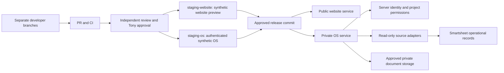

# Infrastructure readiness — November 12, 2026

Status: preparation in a separate infrastructure branch. Nothing here is approval to merge or publish the OS.

## Verified inventory
- Existing repository: Anatoli-2021/grama-construction-website. GitHub reports PUBLIC; older private-repository wording was wrong.
- axmatea has write permission. Railway has an existing Can Edit project member, but the identity match to Nail is not yet confirmed.
- Existing source: website at root; OS at apps/development-os/; shared utilities at packages/shared/; website infrastructure at infra/website/. Preserve these paths.
- Existing Railway project: earnest-wisdom. The existing production service is grama-construction-website.
- Empty staging-website and staging-os environments were created without copying production. Connector read-back confirmed no services, volumes, buckets, shared variables or pending patches immediately after creation.
- Automatic Railway PR environments were disabled in the dashboard. Keep OS previews explicit and synthetic.
- The current OS is a loopback-only blank launch tool. No hosted OS authentication, durable application store or live Smartsheet connection is verified.
- Main-branch protection was prepared in GitHub, but saving triggered identity confirmation. Treat it as NOT APPLIED until the verification handoff records a successful save/read-back.
- Existing CI job verify builds, runs Node tests and repository/artifact policy, and checks the website API/assets. CI runs on PRs and main, with read-only contents permission.
- Earlier branch and deployment descriptions are historical snapshots. Read the actual service source and deployment again before any release.

## Smallest architecture
One repository, one existing Railway project, separate website and authenticated OS services. Separate staging environments isolate configuration and secrets. Keep the website source at root rather than renaming it just for symmetry.

Tony's preferred URL is /platform on the website domain. This requires routing/proxying to the private OS with separate auth, API, asset and cache boundaries; two source folders do not implement it. Do not expose the current blank local tool. Keep the public website runtime free of company records. The precise routing implementation needs review against Claude's backend before configuration.

## What is prepared versus activated
| Area | Prepared | Still required |
| --- | --- | --- |
| Source organization | Existing paths retained; shared agent/handoff instructions | Review and merge this branch |
| Staging | Two empty environments, no production copy | Reviewed build sources, synthetic runtime, cost authorization before resources run |
| Authentication | Server-side individual-login/session contract | Tony selects provider/accounts; implement and test |
| Data | Smartsheet and controlled document-source contracts | Approved read-only application credentials and access tests |
| Release | PR/CI/rollback procedure | Save and verify branch protection; approve exact staging activation |
| Collaboration | Named scopes and shared handoff files | Claude declares active branch/commit and acknowledges handoff |

Read [staging plan](../infra/staging/README.md), [security/integration contract](SECURE-OS-CONTRACT.md), [release procedure](RELEASES.md) and [Claude handoff](CLAUDE-INFRA-HANDOFF.md).

## Outstanding gates and owners
1. Tony: complete GitHub identity verification to save prepared main protection; verify the resulting rule.
2. Claude: finish/checkpoint the current UI task and record its active branch, commit and changed paths.
3. Codex/Claude: agree on the OS backend contract and /platform routing; preserve existing website/contact/presentation routes.
4. Tony: confirm the existing Railway Can Edit member is Nail; approve any additional invitation separately.
5. Tony: choose identity provider, allowed users, synthetic staging resource budget and eventual production release scope.
6. Infrastructure owner: review all branches/history for exposed private data before importing anything. A limited current-tree scan is not a complete historical secret audit.
7. Integration owner: obtain dedicated least-privilege read access to approved Smartsheet sheets; do not reuse a desktop MCP token.
